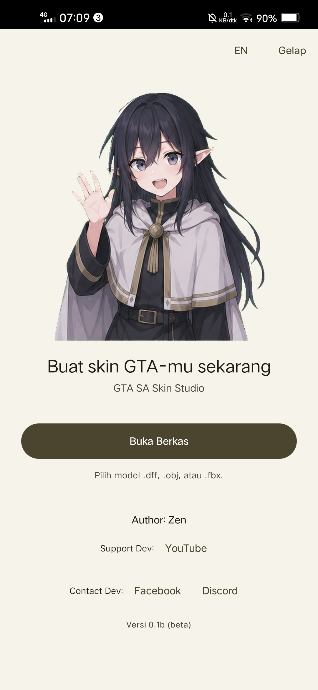
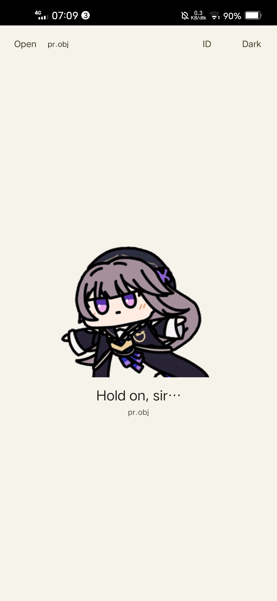
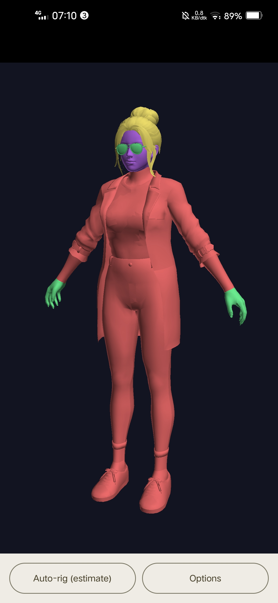
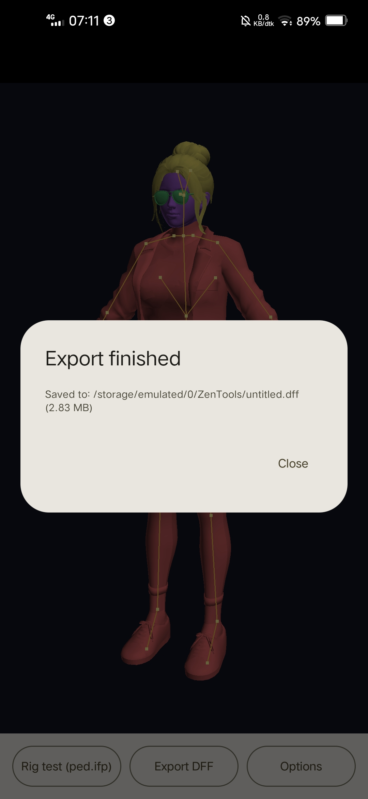
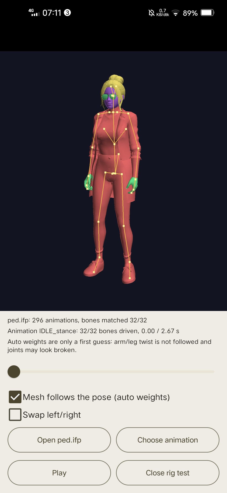

GTA SA Skin Studio

v0.1b — Beta Release

Bikin, periksa, dan ekspor skin GTA San Andreas langsung dari Android!

GTA SA Skin Studio adalah aplikasi Android untuk mengolah model karakter (skin/ped) dari GTA San Andreas Android Classic. Mulai dari membuka model 3D, memasang rig secara otomatis, menguji pose, hingga mengekspor model ke format DFF.

No PC needed. Semua proses bisa dilakukan langsung dari HP Android.

«⚠️ Masih dalam tahap beta. Beberapa fitur mungkin belum sempurna dan hasil ekspor belum sepenuhnya teruji di dalam game. Selalu simpan backup model aslimu sebelum mengedit.»

---

✨ Fitur Utama

- Import berbagai format — DFF, TXD, OBJ (+MTL), dan FBX.
- 3D Model Viewer — Lihat model secara langsung dengan dukungan tekstur TXD, PNG, dan TGA.
- Auto-Rig — Pasang rig humanoid standar GTA SA secara otomatis, lengkap dengan 33 frame dan 32 bone.
- Automatic Weighting — Membantu mengatur bobot mesh agar mengikuti pergerakan tulang.
- Rig Testing — Uji gerakan karakter menggunakan animasi "ped.ifp" dan lihat bagaimana mesh mengikuti pose.
- DFF Export — Ekspor model dengan Skin PLG ke folder "/storage/emulated/0/ZenTools/".
- Mobile-friendly UI — Tampilan minimalis dengan tema gelap/terang dan dukungan bahasa Indonesia serta English.

🔄 Cara Kerja

Proses pengolahan skin dibuat sesederhana mungkin:

1. Import — Buka model yang ingin kamu edit.
2. Auto-Rig — Pasang tulang dan bobot secara otomatis.
3. Test Rig — Periksa apakah tulang dan mesh bergerak dengan benar.
4. Export — Simpan model ke format DFF.
5. Finish — Ambil hasil ekspor dari folder "ZenTools" dan siapkan TXD dengan nama yang sesuai material.

📸 Screenshots

  
  
  

  
  
  

📱 Build Information

Komponen| Versi
Minimum Android| Android 7.0 (API 24)
JDK| 17
Gradle| 8.7
Kotlin| 1.9
Jetpack Compose BOM| 2024.06
Rendering| OpenGL ES 2.0

Build tersedia melalui Android Studio atau GitHub Actions (".github/workflows/android-ci.yml").

📚 Developer Documentation

Ingin tahu lebih jauh tentang pengembangan aplikasi ini? Beberapa dokumentasi teknis tersedia di repository:

- "docs/KONTEKS.md" — Status proyek dan peta kode.
- "docs/ui-v0.1b.md" — Rancangan antarmuka.
- "docs/phase-e-rig-spec.md" — Spesifikasi rig.
- "docs/phase-f-export.md" — Sistem ekspor DFF.
- "docs/weight-model-training.md" — Model automatic weighting.
- "docs/research/" — Catatan riset teknis.

Dokumen tambahan: "FORMAT_SUPPORT.md", "FBX_DECISION.md", "TEST_PLAN.md", dan "GTA_SA_Skin_Studio_Ringkasan_Lengkap.md".

👨‍💻 Credits

Developed by Zen

- YouTube: "@zenskyz6633" (https://www.youtube.com/@zenskyz6633)
- Facebook: "Contact Developer" (https://www.facebook.com/profile.php?id=100052938994711)
- Discord: "Join Community" (https://discord.gg/PgvGucfe)

---

⚖️ License & Disclaimer

© 2026 Zen. All rights reserved. See "LICENSE" (LICENSE) for usage terms.

GTA SA Skin Studio is a closed-source project. Official APK releases are provided free of charge for personal use.

This is an independent fan-made project. It is not affiliated with, endorsed by, or sponsored by Rockstar Games.

Third-party libraries and components remain subject to their respective licenses. See "NOTICE.md" (NOTICE.md) for details.
